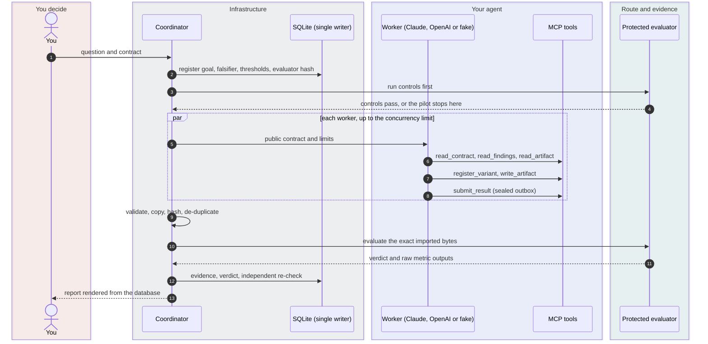
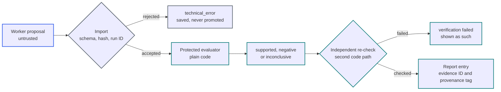
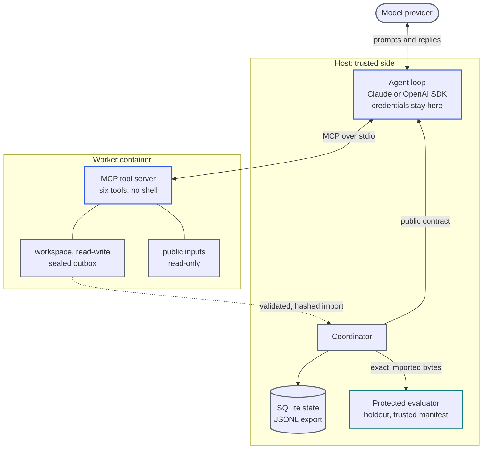

<div align="center">


**Parallel AI research loops that keep their evidence honest.**

For researchers and students working with a coding agent. No coding needed.

[](https://github.com/scaled-thinking/open-research-loops/actions/workflows/tests.yml)
[](#two-ways-to-work)
[](#backends)
[](#measured-not-promised)

[](#names-and-licences)


[Two ways to work](#two-ways-to-work) · [Quickstart](#quickstart) · [How one loop runs](#how-one-loop-runs) · [What a worker can see](#what-a-worker-can-see) · [Backends](#backends) · [Measured, not promised](#measured-not-promised)

<br/>

<picture>
  <source media="(prefers-color-scheme: dark)" srcset="docs/assets/loop-dark.svg">
  
</picture>

</div>

You set the question and what would disprove it, before any result exists. Your agent writes the
code and runs the workers in parallel. Every thread then passes the same needle, a protected
evaluator: what holds joins the report, and what fails stays in it as a negative result.

## Two ways to work

Your own coding agent handles code, evaluators, compute and CI. Pick a mode and paste its starter
into your agent.

### Autonomous

You delegate. The agent proposes a bounded plan and works within your permissions.

```text
Mode: autonomous
Use open-research-loops and follow AGENTS.md. Handle the technical work,
propose a bounded research plan and work within my permissions.
My question: …
```

### Coached

<picture>
  <source media="(prefers-color-scheme: dark)" srcset="docs/assets/competence-dark.svg">
  
</picture>

You learn research design while the experiment gets done. The agent explains and suggests; you
decide on the method.

```text
Mode: coached
Use open-research-loops and skills/rloop-coach/SKILL.md. Coach me on research
design and do the technical work. Explain the methods; let me decide.
Reply in my language. My question: …
```

The agent starts with `rloop init PROJECT --mode coached`, agrees the contract with you and records
your predicted number with `rloop predict` before anything is scored.

<picture>
  <source media="(prefers-color-scheme: dark)" srcset="docs/assets/route-dark.svg">
  
</picture>

| Step |  What your agent does |  Your part and what you learn |
|---|---|---|
| 1. Question and rights  | Checks licences, data rights, privacy and your academic rules where applicable. | Your question and what would disprove it. |
| 2. Metric, target, falsifier | Makes the rule executable. | What the score means. |
| 3. Baselines and controls | Prepares defaults, a team comparison and a random or negative control; checks each was tuned on the same data. | How to spot an unfair test. |
| 4. Approach  | Offers safe, unusual and cheap no-GPU options; recommends one. | Your first idea, then your choice. |
| 5. Pre-register  | Records rule, budget, stop rule and prediction before scoring. | Your number and your reason. |
| 6. Compute and cost | Picks a host, states the cost first, runs a representative smoke test. | Approve resources; what a small test covers. |
| 7. Evaluate once  | Shows the result, its uncertainty and limits. | Your verdict, before the agent's. |
| 8. Reflect | Asks short questions, drafts a method card, proposes profile updates. | The method in your own words. |

The coral person icon  marks the
four moments where your view comes first, one question per reply. Elsewhere the agent gets on with the work and names the
step. Say “shorter”, “explain more” or “just do it” at any time.

The brief is the project's `BRIEF.md`; an optional competence profile stays on your machine. Every
method has a [card](skills/rloop-coach/references/methods.md) with its reason, steps and limits.

**A real example, negative result included.** A small U-Net was scored once against a team's
grain-counting pipeline: val error **0.1639** against **0.1259**, lower is better, so no win. In
review, the owner identified two problems: the team's number was tuned on the same 40 val images,
and 40 images leave a wide 95% interval of 0.119 to 0.231. A coached agent raises a **fair
comparison** and **sample size and intervals** before the run
([what happened](experiments/grain-cnn/README.md#interpretation-added-after-the-result)).

More in [how coached mode works](docs/COACHED.md).

## Quickstart

You need [uv](https://docs.astral.sh/uv/) and Python 3.12+ on Windows or Linux. Nothing here calls a
model provider.

```console
git clone https://github.com/scaled-thinking/open-research-loops
cd open-research-loops
uv sync --locked
uv run rloop init my-pilot --question "Can we recover a planted nonlinear signal?"
```

```text
Simulated fake pilot complete: my-pilot/.rloop/report.md
```

`init` registers a contract, runs the controls, dispatches two deterministic candidates, evaluates
them in a protected subprocess and writes the report. Median from command start to finished pilot:
**1.15 s** on Windows, **1.41 s** on Linux, excluding installation.

The report is rendered from the database. Each run links its evidence, and every statement carries a
provenance tag:

```text
| Run                 | Execution | Scientific outcome | Verification | Development MSE         |
|---------------------|-----------|--------------------|--------------|-------------------------|
| 46d657d8-agent-7-00 | completed | negative           | checked      | 28.421875 (evidence)    |
| 46d657d8-agent-7-01 | completed | supported          | checked      | 0 (evidence)            |

[simulated] Attempted variants: 2.
[measured] Control/final evaluation starts: 2.
[measured] External model cost: USD 0.000000 (offline fake only).
[cited] Synthetic dataset license: CC0-1.0.
```

The full example campaign runs 48 variants: an agent arm against a random baseline, eight per seed
across three registered seeds.

```console
uv run rloop run examples/planted-signal            # dispatch, import, evaluate; safe to repeat
uv run rloop status examples/planted-signal
uv run rloop report examples/planted-signal --check # regenerate from the DB and compare
uv run rloop run examples/planted-signal --final    # seal the campaign; allowed once
uv run pytest
```

Repeating `run` or `resume` never reruns a completed candidate. `uv run python scripts/measure_init.py`
reproduces the timing on your machine.

> [!NOTE]
> The planted-signal example is **simulated**: its fake workers know the answer on purpose, so it
> shows that the machinery works, not that agents can do research. In the
> [live pilot](docs/CHECKPOINT-B-PILOT.md), real models from two vendors found the same planted
> answer from the public training samples. A real question needs its own data, contract and evaluator.

## How one loop runs



Workers never write to the database. They write to a private outbox that the coordinator treats as
untrusted input. One coordinator per project holds the lock; SQLite stays authoritative, and reports
and the append-only JSONL export are read from it.

### The evidence gate

Every candidate passes the same gate, whatever its outcome:



Execution status, scientific outcome and verification are separate fields: a finished run is not a
finding, a negative result is checked evidence, and an interrupted worker never becomes a positive
one. Every report statement is tagged `measured`, `simulated`, `cited`, `assumed`, `interpretation`
or `hypothesis`.

## What a worker can see

Isolation does not depend on which agent SDK runs the worker. Every backend gets the same six MCP
tools and nothing else; the tests check the effective tool list for each backend.



- **Never reaches a worker:** evaluator code, holdout and final data, the database, credentials,
  final scores.
- **Two sandbox modes.** `none` serves declarative tools and refuses candidate code. `container`
  runs the tools in an OCI container (Docker or Podman, pinned by digest): no network, read-only
  root, non-root user, no capabilities, limits on processes, memory, CPU and wall time.
- **Fail closed.** Four probes must pass before a container worker starts: private paths absent,
  writes outside the workspace fail, network unreachable, timeouts clean up the whole process tree.
- **Honest limits.** Containers share the host kernel: they stop mistaken or opportunistic worker
  actions, not a determined kernel exploit. See the
  [threat model](docs/DESIGN.md#phase-3b-sandbox-policy-and-threat-model).

## Why this exists

Thirteen submissions to the *Claude Impact Lab x Foresight Institute — AI Research Loops for Open
Science Problems* hackathon (Berlin, November 2026) pointed agent loops at open science problems.
Their published assessments show the same failures again and again, and those failures are about
the loop, not the science. `rloop` turns each one into a rule the runtime enforces.

| What the assessments found | What `rloop` enforces |
|---|---|
| A planner loosened its own success threshold | Goal, falsifier, thresholds, seeds and evaluator hash are registered and immutable before the first dispatch |
| A later prompt included test scores; truth files sat in public view | Workers see an allowlisted public projection. Evaluator, holdout and database never enter their view. The final evaluation is a one-use ticket |
| A stale verdict was picked by file modification time | Imports are hash-checked and content-addressed; selection uses immutable IDs, never mtimes |
| Planted defects were too easy to catch; a review target was constant | Controls run first. A failed or uninformative control blocks the pilot |
| Variants went uncommitted; single seeds; intervals dropped | Every proposal, variant and retry gets a durable attempt ID. Seeds, keep margin and intervals appear in the report |
| An orchestrator changed a protected spec together with its hash | Hash anchors sit outside worker authority. A change needs a recorded human decision and creates a new version |
| Headline numbers had no saved artifacts behind them | Reports render from the database, every statement carries a provenance tag, and CI fails when a committed report drifts |

Each lesson with a link to its assessment: [LESSONS](docs/LESSONS.md).

## Backends

| Backend | Install | Signs in with | Status |
|---|---|---|---|
| `fake` | base package | nothing; deterministic and offline | Default. Drives the example and CI |
| `claude_agent` | `uv sync --extra claude` (Claude Agent SDK) | your own Claude Code login | Live pilot passed: 8/8 supported ([record](docs/CHECKPOINT-B-PILOT.md)) |
| `openai_agents` | `uv sync --extra openai` (OpenAI Agents SDK) | Sign in with ChatGPT for open-source apps (preview): `rloop auth login-openai` | Live pilot passed: 8/8 supported ([record](docs/CHECKPOINT-B-PILOT.md)) |

- **Subscription sign-in by default.** An API key in the environment never authorizes a call;
  API-key mode is an explicit choice.
- **The owner approves each live run.** The authorization in `project.json` names the owner,
  provider, exact model, auth mode, effort and four run limits. `rloop init --owner NAME` sets the
  owner (default: Git `user.name`, then the OS login). Without an authorization, `rloop pilot`
  refuses before any SDK or tool starts.
- **No silent fallback.** A rate or usage limit stops the pilot and cancels its siblings: no retry,
  no switch to another model, account or auth mode.
- **Honest cost.** Token usage is recorded and cost is estimated; an unknown cost stays unknown,
  never zero.

```console
$ uv run rloop auth preflight --backend claude_agent        # offline check, reads no credentials
$ uv run rloop auth login-openai                            # browser sign-in, Sign in with ChatGPT
$ uv run rloop auth models                                  # models your account lists; no automatic fallback
$ uv run rloop pilot pilots/claude --backend claude_agent --workers 8
```

Step-by-step handoff with example configs: [CHECKPOINT-B-PREP](docs/CHECKPOINT-B-PREP.md). Training
jobs run separately through `rloop compute` on a local, Kaggle, manual (for example Colab) or
command-configured host: [COMPUTE](docs/COMPUTE.md).

## Measured, not promised

| What | Result |
|---|---|
| Command start to completed simulated pilot, three runs each | Windows median **1.152 s**; Linux median **1.408 s** |
| Test suite, offline, network blocked in the test process | CI: Ubuntu **463 passed, 1 skipped**; Windows **457 passed, 7 skipped** (container tests skip there). Real worker and evaluator containers included |
| First live pilot, planted-signal, 8 worker runs per backend | `claude-sonnet-5-5`: **8/8 supported** in 2 min 11 s, estimated USD 0.32 in total. `gpt-6.1-terra`: **8/8 supported** in 2 min 01 s, about 72k tokens, cost not reported under ChatGPT sign-in. Every first submission was valid |
| First real problem, grain counting on 316L micrographs, 4 worker runs per backend | Controls reproduced to 1e-9; 8/8 completed and re-checked on the first attempt. Best development `max_rel_error`: Terra **0.126**, the published baseline resubmitted; Sonnet **0.141**. Pre-registered target 0.10 **not reached**. Holdout: 0.176 and 0.182 |
| Grain U-Net, one pre-registered training run | Val `max_rel_error` **0.1639**, scored once; team pipeline 0.1259. **No win** ([record](experiments/grain-cnn/README.md)) |
| SDK adapters | Real SDK orchestration against a stub CLI and a stub streaming endpoint, with real MCP subprocesses; no provider runner mocked out |

Commands and raw results: [Phase 2](docs/PHASE-2-STATUS.md), [Phase 3](docs/PHASE-3-STATUS.md), the
[pilot record](docs/CHECKPOINT-B-PILOT.md) with every live attempt (six failed before the worker
protocol fix) and the [Phase 4b record](docs/PHASE-4B-PILOT.md). Not yet done: a positive scientific
result, a PyPI release.

## Roadmap

| Stage | Scope | Status |
|---|---|---|
| Phase 0 | Lessons, prior art, design, requirements | Done |
| Phase 1–2 | Offline vertical slice and the integrity gates | Done |
| Phase 3 / 3b | MCP over stdio, Claude and OpenAI adapters, OCI sandbox | Done |
| Checkpoint B | Subscription sign-in, run-limit gate, `rloop pilot`, then eight live workers per backend | Done: 8/8 supported on both |
| Phase 4a | Seven portable `rloop-*` agent skills with an installer, a short [guide](docs/GUIDE.md), `rloop self-assess` | Done |
| Phase 4b | One licensed real problem from question to pilot: grain counting on 316L steel micrographs | Done: target not reached ([record](docs/PHASE-4B-PILOT.md)) |
| Compute and coaching | `rloop compute` hosts, a U-Net feasibility run, coached mode with `rloop predict` | Done |
| Phase 5 | Provider comparison on real work | Later |

## Repository map

```text
src/research_loops/
├── coordinator.py, scheduler.py, storage.py      state, dispatch, limits, recovery
├── tools.py, transports/                         the six MCP tools, served over stdio
├── adapters/                                     fake, claude_agent, openai_agents
├── evaluation.py, evaluator_worker.py            protected evaluator subprocess
├── protection.py, authorization.py               hash anchors, run authorization
├── openai_auth.py, auth_cli.py                   Sign in with ChatGPT, protected token store
├── sandbox.py, container_stdio.py                OCI isolation and preflight probes
├── verification.py, grounding.py, reporting.py   re-checks, provenance, reports
├── compute/                                      vendor-neutral training jobs
└── migrations/                                   numbered SQLite migrations
examples/planted-signal/                          the simulated first example
experiments/grain-cnn/                            the U-Net feasibility run
skills/                                           portable agent skills, incl. rloop-coach
docs/                                             lessons, design, decisions, status
tests/                                            offline tests, incl. container isolation
```

## Documentation

| Document | Read it for |
|---|---|
| [GUIDE](docs/GUIDE.md) | Offline commands from install to the grain benchmark |
| [COACHED](docs/COACHED.md) | Coached mode: the route, levels, competence profile |
| [LESSONS](docs/LESSONS.md) | What the thirteen assessments showed, and the rule each lesson became |
| [DESIGN](docs/DESIGN.md) | Architecture, contracts, information flow, database, threat model |
| [REQUIREMENTS](docs/REQUIREMENTS.md) | Every requirement traced to a design section and an acceptance check |
| [DECISIONS](docs/DECISIONS.md) | Owner decisions per checkpoint |
| [CHECKPOINT-B-PILOT](docs/CHECKPOINT-B-PILOT.md) | Every live attempt on both vendors, what failed, why, and what fixed it |
| [COMPUTE](docs/COMPUTE.md) | Training jobs on local and hosted compute |
| [PRIOR-ART](docs/PRIOR-ART.md) | Credited sources, SDK references, pinned versions |

## Names and licences

The distribution is `research-loops`, the import is `research_loops`, the command is `rloop`. It is
not on PyPI yet; install from source as shown above. The unrelated PyPI package `rloop`, a Rust
asyncio event loop, is never a dependency.

Code is licensed under [Apache-2.0](LICENSE), documentation under [CC BY 4.0](LICENSE-CC-BY-4.0); see
[NOTICE](NOTICE). The core is an independent implementation. Ideas from the event's material and
other projects are credited in [PRIOR-ART](docs/PRIOR-ART.md); no AGPL code is included.
