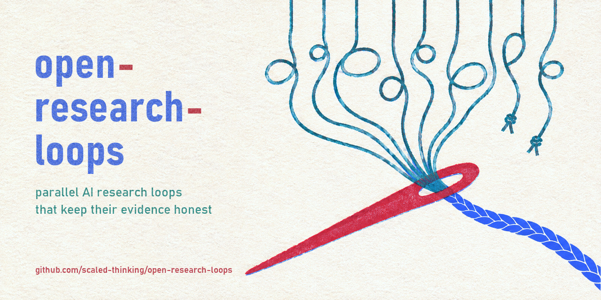
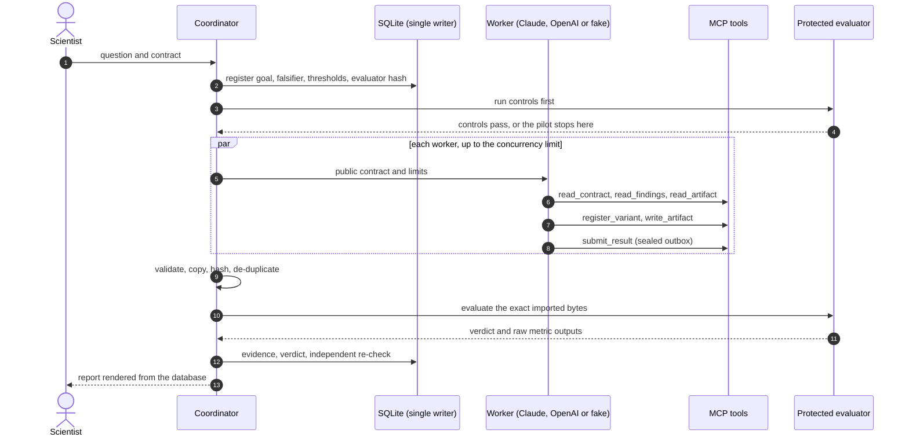
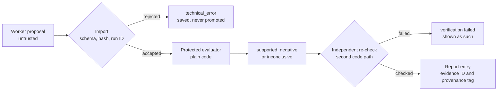
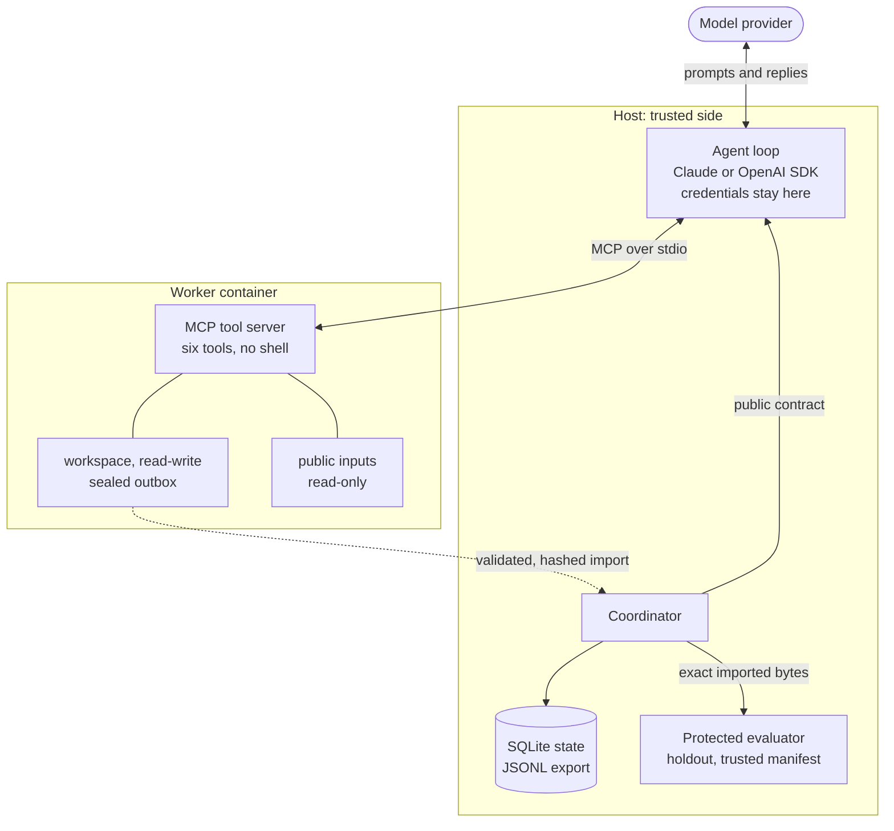

<div align="center">



**Parallel AI research loops that keep their evidence honest.**

Lock the question before anyone looks at results. Fan out agent workers. Score every candidate with protected, plain-code evaluation.<br/>
Publish only what the saved evidence supports, negative results included.

[](https://github.com/scaled-thinking/open-research-loops/actions/workflows/tests.yml)


[](LICENSE)
[](LICENSE-CC-BY-4.0)


<br/>

<picture>
  <source media="(prefers-color-scheme: dark)" srcset="docs/assets/loop-dark.svg">
  
</picture>

</div>

## Why this exists

This repository carries lessons from the *Claude Impact Lab x Foresight Institute — AI Research Loops for Open Science Problems* hackathon (Berlin, 7 November 2026). Thirteen submissions pointed agent loops at open science problems. The published assessments show the same failure modes again and again, and they are rarely about the science. They are about the loop: a threshold that moved mid-run, a prompt that leaked test scores, a headline result whose artifacts were never saved.

The method was already written down. What was missing was a **runtime that enforces it**. `rloop` is that runtime, and its headline goal is simple: **get from a question to the first running experiment fast**, then iterate without losing the evidence trail.

| What the assessments found | What `rloop` enforces |
|---|---|
| A planner loosened its own success threshold | Goal, falsifier, thresholds, seeds and evaluator hash are registered and immutable before the first dispatch |
| A later prompt included test scores; truth files sat in public view | Workers see an allowlisted public projection. Evaluator, holdout and database never enter their view. The final evaluation is a one-use ticket |
| A stale verdict was picked by file modification time | Imports are hash-checked and content-addressed; selection uses immutable IDs, never mtimes |
| Planted defects were too easy to catch; a review target was constant | Controls run first. A failed or uninformative control blocks the pilot |
| Variants went uncommitted; single seeds; intervals dropped | Every proposal, variant and retry gets a durable attempt ID. Seeds, keep margin and intervals appear in the report |
| An orchestrator changed a protected spec together with its hash | Hash anchors sit outside worker authority. A change needs a recorded human decision and creates a new version |
| Headline numbers had no saved artifacts behind them | Reports render from the database, every statement carries a provenance tag, and CI fails when a committed report drifts |

Details, with links to each assessment: [docs/LESSONS.md](docs/LESSONS.md).

## Quickstart

You need [uv](https://docs.astral.sh/uv/) and Python 3.12+. Nothing here calls a model provider.

```console
git clone https://github.com/scaled-thinking/open-research-loops
cd open-research-loops
uv sync --locked
uv run rloop init my-pilot --question "Can we recover a planted nonlinear signal?"
```

Add `--owner "Your Name"` to choose the project owner. Otherwise init records Git's `user.name`, falling back to the OS login. The identity and its source stay in host-only `project.json`; later approvals must match it exactly after stripping whitespace.

```text
Simulated fake pilot complete: my-pilot/.rloop/report.md
```

`init` registers a contract, runs the controls, dispatches two deterministic candidates, imports their outputs, evaluates them in a protected subprocess and writes the report. The measured median from command start to finished pilot is **1.15 s on Windows and 1.41 s on Linux**, excluding installation.

```console
$ uv run rloop status my-pilot
46d657d8-agent-7-00: completed / negative
46d657d8-agent-7-01: completed / supported
```

The report is rendered from the database. Each run links its evidence object, and every statement carries a provenance tag:

```text
| Run                 | Execution | Scientific outcome | Verification | Development MSE         |
|---------------------|-----------|--------------------|--------------|-------------------------|
| 46d657d8-agent-7-00 | completed | negative           | checked      | 28.421875 (evidence)    |
| 46d657d8-agent-7-01 | completed | supported          | checked      | 0 (evidence)            |

[simulated] Attempted variants: 2.
[measured] Control/final evaluation starts: 2.
[measured] External model cost: USD 0.000000 (offline fake only).
[cited] Synthetic dataset license: CC0-1.0.
```

The full example campaign runs 48 variants, an agent arm against a random baseline, eight per seed across three registered seeds, dispatched best-of-N under the concurrency limit:

```console
uv run rloop run examples/planted-signal            # dispatch, import, evaluate; safe to repeat
uv run rloop status examples/planted-signal
uv run rloop report examples/planted-signal --check # regenerate from the DB and compare
uv run rloop run examples/planted-signal --final    # seal the campaign; allowed once
uv run pytest
```

Repeating `run` or `resume` reconciles saved work and never reruns a completed candidate. `uv run python scripts/measure_init.py` reproduces the timing above on your machine.

> [!NOTE]
> The planted-signal example is **simulated**. Its fake workers know the answer on purpose, so it shows that the machinery works, not that agents can do research. A real question still needs its own data, contract and evaluator.

## How one loop runs



Workers never write to the database. They write to a private outbox that the coordinator treats as untrusted input. One coordinator per project holds the lock; reports and the append-only JSONL export are read from the database, so the Git history stays reviewable while SQLite stays authoritative.

### The evidence gate

A candidate becomes a reportable result only through the same gate, whatever its outcome:



Execution status, scientific outcome and verification are three separate fields. A run that finished is not a finding, a negative result is checked evidence, and an interrupted worker can never turn into a positive result. Every report statement is tagged `measured`, `simulated`, `cited`, `assumed`, `interpretation` or `hypothesis`.

## What a worker can see

Isolation does not depend on which LLM SDK runs the worker. Every backend gets the same six MCP tools and nothing else. The SDKs' built-in tools are switched off, and the tests check the effective tool list for each backend.



- **Never reaches a worker:** evaluator code, holdout and final data, the database, credentials, final scores.
- **Two sandbox modes.** `none` serves declarative MCP tools and refuses to execute candidate code. `container` runs the tools in an OCI container through Docker or Podman, with no network, a read-only root, a non-root user, all capabilities dropped and limits on processes, memory, CPU and wall time. Images are pinned by digest.
- **Fail closed.** Before a container worker starts, four probes have to pass: private paths are absent, writes outside the workspace fail, the network is unreachable, and a child-spawning timeout cleans up the whole process tree. A missing runtime or a failed probe blocks the task.
- **Honest limits.** Containers share the host kernel. They protect against mistaken or opportunistic worker actions, not a determined kernel exploit. The threat model is in [docs/DESIGN.md](docs/DESIGN.md#phase-3b-sandbox-policy-and-threat-model).

## Backends

| Backend | Install | Signs in with | Status |
|---|---|---|---|
| `fake` | base package | nothing; deterministic and offline | Default. Drives the example and CI |
| `claude_agent` | `uv sync --extra claude` (Claude Agent SDK) | your own Claude Code login | Built and tested offline. Live runs gated |
| `openai_agents` | `uv sync --extra openai` (OpenAI Agents SDK) | Sign in with ChatGPT for open-source apps (preview): `rloop auth login-openai` | Built and tested offline. Live runs gated |

Subscription sign-in is the default. An API key in the environment **never** authorizes a call; API-key mode has to be chosen explicitly. A live run needs an authorization in the project config that names the approving owner, the provider, the exact model, the auth mode, the effort and four run limits: worker runs, parallel workers, turns per worker and wall time per worker. The coordinator checks it before it imports any SDK or starts any tool. A rate or usage limit stops the pilot and cancels its siblings. There is no retry and no silent fallback to another model, account or auth mode. Token usage is recorded, and cost is recorded as an estimate; an unknown cost stays unknown and is never written as zero.

```console
$ uv run rloop auth preflight --backend claude_agent        # offline check, reads no credentials
$ uv run rloop auth login-openai                            # browser sign-in, Sign in with ChatGPT
$ uv run rloop auth models                                  # models your account lists; no automatic fallback
$ uv run rloop pilot pilots/claude --backend claude_agent --workers 8
```

Without an authorization in `project.json`, `rloop pilot` refuses before any SDK or tool starts. The step-by-step handoff, with example configs, is in [docs/CHECKPOINT-B-PREP.md](docs/CHECKPOINT-B-PREP.md).

## Measured, not promised

| What | Result |
|---|---|
| Command start to completed simulated pilot, three runs each | Windows median **1.152 s**; Linux median **1.408 s** |
| Test suite | **144 passed** locally on Windows, offline, network blocked in the test process; real worker and evaluator containers included. CI: 144 on Ubuntu, 138 plus 6 container skips on Windows |
| SDK adapters | Real SDK orchestration against a stub CLI and a stub streaming endpoint, with real MCP subprocesses; no provider runner mocked out |

Exact commands and results are in [Phase 2](docs/PHASE-2-STATUS.md), [Phase 3](docs/PHASE-3-STATUS.md) and the [checkpoint-B handoff](docs/CHECKPOINT-B-PREP.md). What has **not** happened yet: no live provider run, no real scientific problem run end to end, no PyPI release.

## Roadmap

| Stage | Scope | Status |
|---|---|---|
| Phase 0 | Lessons, prior art, design, requirements | ✅ done |
| Phase 1–2 | Offline vertical slice and the integrity gates | ✅ done |
| Phase 3 / 3b | MCP over stdio, Claude and OpenAI adapters, OCI sandbox | ✅ done |
| Checkpoint B | Subscription sign-in, run-limit gate, `rloop pilot`: built and tested offline | ✅ built |
| First live pilot | Eight workers per backend on the planted-signal example, under explicit run limits | ⏳ waiting for the owner's go |
| Phase 4 | Portable `rloop-*` agent skills, a short guide, one licensed real problem from question to pilot | ⏳ next |
| Phase 5 | Provider comparison on real work | ⏳ later |

## Repository map

```text
src/research_loops/
├── coordinator.py, scheduler.py, storage.py      state, dispatch, limits, recovery
├── tools.py, transports/                         the six MCP tools, served over stdio
├── adapters/                                     fake, claude_agent, openai_agents
├── evaluation.py, evaluator_worker.py            protected evaluator subprocess
├── protection.py, authorization.py               hash anchors, run authorization
├── openai_auth.py, auth_cli.py                   Sign in with ChatGPT, protected token store
├── sandbox.py, container_stdio.py                OCI isolation and preflight probes
├── verification.py, grounding.py, reporting.py   re-checks, provenance, reports
└── migrations/                                   numbered SQLite migrations
examples/planted-signal/                          the simulated first example
docs/                                             lessons, design, decisions, status
tests/                                            offline tests, incl. container isolation
```

## Documentation

| Document | Read it for |
|---|---|
| [LESSONS](docs/LESSONS.md) | What the thirteen assessments showed, and the rule each lesson became |
| [DESIGN](docs/DESIGN.md) | Architecture, contracts, information flow, database, threat model |
| [REQUIREMENTS](docs/REQUIREMENTS.md) | Every requirement traced to a design section and an acceptance check |
| [DECISIONS](docs/DECISIONS.md) | Owner decisions per checkpoint |
| [CHECKPOINT-B-PREP](docs/CHECKPOINT-B-PREP.md) | Sign-in, authorization config and pilot commands for the first live run |
| [PRIOR-ART](docs/PRIOR-ART.md) | Credited sources, SDK references, pinned versions |

## Names and licenses

The distribution is `research-loops`, the import is `research_loops`, the command is `rloop`. It is not on PyPI yet; install from source as shown above. The unrelated PyPI package `rloop`, a Rust asyncio event loop, is never a dependency.

Code is licensed under [Apache-2.0](LICENSE), documentation under [CC BY 4.0](LICENSE-CC-BY-4.0); see [NOTICE](NOTICE). The core is an independent implementation. Ideas from the event's material and other projects are credited in [PRIOR-ART](docs/PRIOR-ART.md); no AGPL code is included.
