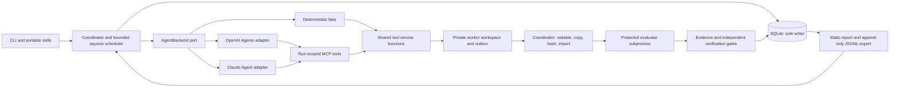
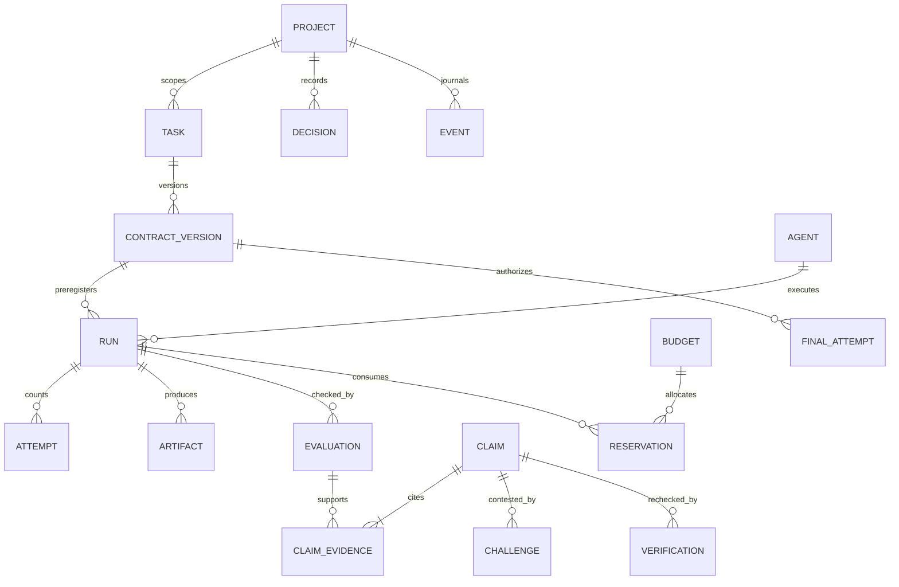

# Internal design — checkpoint A approved

Status: **Checkpoint A approved; Phase 1-2 delivered. Phase 3 not started.** See [DECISIONS.md](DECISIONS.md) for the binding decisions and [PHASE-2-STATUS.md](PHASE-2-STATUS.md) for proof and limits.
The start prompt is the mandate; [LESSONS.md](LESSONS.md) records evidence and [REQUIREMENTS.md](REQUIREMENTS.md) traces implementation obligations.
This document describes the complete intended design; delivery status and verification are recorded separately. Unimplemented mechanisms are not claimed as working.
Repository title `open-research-loops`, distribution `research-loops`, import `research_loops`, and CLI `rloop` are approved. Never depend on the unrelated PyPI `rloop` package.

## Architecture

A Python 3.12+ library owns research state and integrity; SDKs only execute bounded assignments.
Use `uv`, Pydantic, Typer, stdlib SQLite, and pytest, with the candidate versions in [PRIOR-ART.md](PRIOR-ART.md).
The core imports no vendor SDK or MCP transport.
No ORM, application web server, external queue, Postgres implementation, or hosted control plane is planned.



Suggested package boundaries are `domain`, `ports`, `coordinator`, `scheduler`, `storage/sqlite`, `evaluation`, `tools`, `adapters`, and `cli`.
The CLI uses application operations; adapters do not own research policy, database sessions, or claim promotion.
One project has one local database and one coordinator lock across CLI processes.
Reports can use read-only snapshot connections.
Remote workers, distributed scheduling, paper writing, and arbitrary external literature connectors are outside v0.

## Domain and contracts

Pydantic objects reject unknown fields, non-finite numbers, mismatched IDs and invalid state transitions.
Immutable objects serialize as canonical UTF-8 JSON with sorted keys, fixed separators and no NaN; binary artifacts hash their exact bytes with SHA-256.
An ID names a particular record; a hash identifies its contents. Neither replaces the other.

| Object | Required content / invariant |
|---|---|
| Project | Question, scope, phase, repository revision, approved execution policy, current contract version and overall limits. Unknown scientific assumptions remain explicit. |
| ContractVersion / PreRegistration | Task, goal, falsifier, metric definitions and units, thresholds, keep margin, interval/selection rule, baseline/control IDs, data/split references, evaluator ID/version/code hash, allowed edits, output schema, stop rules, license references, reason and superseded version. Immutable before dispatch. |
| Prediction | Run/variant ID, contract hash, predicted outcome and disproof condition, timestamp and content hash. Stored before execution, including a declared uncertain prediction. |
| WorkerContract | An explicit public projection of the registration: allowed inputs, relevant findings/challenges, candidate schema, allowed paths/tools, limits and skill hashes. Never contains private evaluator configuration, final labels, final seed or final scores. |
| Limits | Shared absolute deadline, worker wall-time/turn/output/token bounds, maximum attempts, concurrency and reserved cost ceiling. No worker can increase them. |
| WorkerReport | Schema/report/run/task/attempt IDs, contract and prompt hashes, artifact descriptors, candidate/code reference, seed, input hashes, backend/provider/model/SDK/runtime versions, transcript reference, usage and cost provenance, errors and proposed statements. Worker metrics are non-authoritative. |
| EvaluationRequest / Verdict | Exact imported artifact IDs/hashes, registration/evaluator/input versions, evaluation mode and limits; verdict includes raw-output and metric references, control results, interval method and validity limits. Empty/malformed/non-finite/timeout output is an evaluation error. |
| Claim / Challenge | Claim text, one of `measured`, `simulated`, `cited`, `assumed`, `interpretation`, `hypothesis`, scope/units and evidence IDs; challenge names its target, grounds, evidence and next check. Corrections and resolutions append new records. |

Execution statuses are `planned`, `running`, `completed`, `technical_error`, `timed_out`, `cancelled`, `interrupted`.
Scientific outcomes are nullable until evaluated, then `supported`, `negative`, or `inconclusive`.
Verification is independently `unverified`, `checked`, or `failed`; promotion also requires the separate independent-check record.
A completed negative experiment can be checked evidence; an interrupted worker cannot become a positive finding.
An unresolved challenge makes a claim contested in the current projection without changing its original statement or measurements.
Citation-only and assumption statements have typed provenance but cannot masquerade as experimentally evaluated findings.

Each generated variant, including an internal rejected proposal, gets a durable attempt ID through the tool service before evaluation.
A flushed append-only outbox journal records proposals, request/retry starts and usage as they happen, not just at final submission.
The coordinator imports these journal entries by unique IDs even when the worker dies without a sealed report; a partial outbox never becomes a successful result.
A code-capable worker must declare each candidate mutation; its isolated runner records candidate snapshots at execution boundaries.
Counting unobservable private model deliberation is impossible; the contract counts observable proposals, tool executions, retries and dispatched variants, and documents that boundary.

## Ports

These are domain interfaces, not vendor SDK signatures. Phase 2 uses immutable JSON bytes at the single evaluator boundary; a richer request object can be introduced when multiple evaluator implementations need it.

```python
class AgentBackend(Protocol):
    async def run(
        self, contract: WorkerContract, workspace: WorkerWorkspace, limits: Limits
    ) -> WorkerReport: ...

class Evaluator(Protocol):
    def evaluate(self, candidate: bytes, dataset: bytes, seconds: float) -> Verdict: ...

class ResearchRepository(Protocol):
    def register(self, contract: dict, evaluator_hash: str, inputs: dict) -> str: ...
    def import_report(self, report: WorkerReport, outbox: Workspace) -> bool: ...
```

The evaluator interface executes in a coordinator-launched subprocess using an explicit JSON request/response protocol.
The concrete repository also owns dispatch/reservation, verdicts, claims/challenges and final tickets; recovery is coordinated above it.
It cannot be called as a worker tool; the coordinator selects evaluator identity from the registration, never from report text.
The coordinator validates request and response schemas, process return status, output limits and hashes.
Backend exceptions become technical outcomes with saved diagnostic artifacts; no exception path invents a successful report.

## Worker tools and backend equivalence

One MCP server implementation exposes the same run-scoped Python service functions to every backend.
With stdio there is a separate instance per worker connection; this is not a shared database-writing server or a web service.
It receives a frozen context bundle and capability scope, not a database connection or evaluator-side paths.
The fake backend invokes those same functions directly; transport parity is tested separately from model behavior.

| Tool | Behavior |
|---|---|
| `read_contract()` | Return the assigned public contract and versions. Assignment is bound at startup, not selected by caller-supplied project ID. |
| `read_findings(ids)` | Read allowlisted, visibility-filtered claims/challenges from the frozen bundle. Final-evaluation artifacts are never included. |
| `read_artifact(relative)` | Read an allowed input or own artifact as UTF-8 text, falling back to base64 for binary; retain SHA-256 and byte size. No arbitrary filesystem or URL access. |
| `register_variant(proposal)` | Append an outbox proposal with ID, parent, prediction, rationale and attempt accounting. Refuse local scope exhaustion. |
| `write_artifact(relative, content, encoding="utf-8")` | Save bounded UTF-8 notes (explicit `encoding="base64"` for binary); return path/hash/size. Reject overwrites, traversal and host-reserved candidate/transcript paths. |
| `submit_result(candidate)` | Validate the expression tree; return a correctable tool error on failure. The host writes candidate.json and transcript.json (canonical public JSON prompt and candidate response), fills trusted scope/hashes/seed, and seals one report in the outbox. It proposes evidence; it does not modify the database or promote claims. |

All tool outputs and source passages are untrusted data for instruction purposes.
No generic shell, evaluator execution, SQL, uncontrolled retrieval, subprocess launch or new-agent tool is exposed in the default worker profile.
The tool service rejects absolute/drive/UNC paths, `..`, symlinks, Windows junctions/reparse points and cross-run references.
Use a newly created, exclusive workspace; OS isolation is still required if another actor can mutate paths during access.

`fake`, `openai_agents`, and `claude_agent` implement the port; project config selects the default, with optional per-task overrides.
Required SDKs are optional `[openai]` / `[claude]` extras; loading `fake` must not require either.
Use explicit SDK instructions, schemas and local MCP configuration, with telemetry export disabled by default.
The [primary SDK references](PRIOR-ART.md#primary-sdk-and-tool-documentation) govern implementation.
In Claude, disabling builtin tools and rejecting unknown calls is essential: `allowed_tools` alone is insufficient.
No SDK-native subagent scheduling is enabled behind the coordinator's budget ledger.
Different providers may share a project; every run records the exact model and access route, without storing credentials.

## Evaluator protection and information flow

The threat model includes mistaken or adversarial **worker actions**, not a malicious project owner or compromised SDK/runtime.
The coordinator, tool implementation, evaluator and launch policy form the trusted computing base.
A worker with arbitrary host execution can defeat same-user filesystem separation; a separate subprocess, worktree, read-only Git file or virtual environment is not a sandbox.

Default v0 workers manipulate **declarative candidates** through the restricted tool interface.
The evaluator interprets a bounded validated data format; it never `eval`s, imports, unpickles or executes candidate code in its protected process.
The worker cannot address evaluator storage through any exposed capability.
Evaluator source/tests, trusted manifest, final dataset and final receipts reside outside worker workspaces and worker Git history.
The coordinator verifies their hashes at preflight and immediately before use.

For code-changing tasks, Phase 3b introduces a `Sandbox` port with `none` and `container` adapters.
`none` permits only declarative tool operations and refuses candidate code execution.
`container` invokes a configurable Docker or Podman CLI (common flags, no docker-py), using digest-pinned OCI images built from a `Containerfile`.
The host retains the agent loop and API keys; tools alone run through container stdio MCP (`run -i` / `exec -i`). SDK built-in tools are disabled, and every backend must pass the same isolation contract tests.
Mount only the workspace read-write and public inputs read-only. Never mount evaluator, holdout, database, or credentials.
Require `--network none`, non-root user, `--read-only` root plus tmpfs, `--cap-drop ALL`, `--security-opt no-new-privileges`, pids/memory/CPU and wall-time limits; record the image digest in the run.
An evaluator needing generated code runs it in its own container with read-only holdout and measures bounded outputs, never importing candidate code into the evaluator process.
Preflight probes verify forbidden reads, forbidden writes outside the workspace, no network, and complete process-tree cleanup. Any failure or missing runtime blocks the task.
Containers share the host kernel; they protect against mistaken/opportunistic worker actions, not determined kernel exploits. Optional gVisor `runsc` and hosted sandbox adapters may come later, never as requirements.
Build Phase 3b only after fake and both SDK adapters pass shared tests. Container tests run on Linux CI and locally; GitHub Windows runners skip visibly because they cannot run Linux containers. No code-changing example is included now.

Pre-registration pins verdict **code**, not merely a prose goal or mutable configuration.
Changing criteria, protecting tests or evaluator code requires a human decision record naming old/new hashes and reason; it creates a new registration/evaluator version and flags affected comparisons.
CI compares protected manifests against its trusted base revision and decision history; changing a spec and hash together is rejected without the authorizing record.
This protects against worker edits, not an owner rewriting Git/decision history.

Information flows are typed: `worker_public`, `coordinator_only`, `evaluator_only`, `final_revealed`.
Public context is constructed by allowlist, never by deleting a few sensitive keys from a full database dump.
Log the exact application-supplied prompt, selected skills, tool outputs, SDK messages available to us, and hashes.
Provider-internal prompts are not observable and must not be claimed as captured.
Leak tests use private canary values and field provenance across recorded prompts, tool results, errors, summaries, and resumed history; a numeric substring scan alone is not proof of non-leakage.

Development metrics may guide selection.
Before `run --final`, freeze the chosen candidate and close that project campaign to new worker dispatch.
Commit a one-use final attempt against the **project plus held-out dataset/split identity**, independent of candidate or evaluator version, before opening the split.
A crash consumes the ticket; recovery can import the durable receipt, never open the split again automatically.
Changed criteria do not reset the ticket.
Independent final verification uses a second metric code path over the same sealed raw predictions **inside that one final attempt**; it does not request another final evaluation.
The report can reveal final results after sealing; resume cannot feed them back into workers.
A genuinely new research campaign must use a fresh held-out split and disclose the prior exposure.

## Database schema and persistence

SQLite uses `sqlite3`, WAL, foreign keys on every connection, a bounded busy timeout, parameterized statements and short explicit transactions.
One coordinator writer holds an OS-backed project lock for its lifetime.
Numbered SQL migrations have stored checksums; no destructive automatic migration of an existing toolkit database is proposed.
The toolkit model informs the design; migrations add only tables with working consumers. Use integer USD micro-units instead of floating-point money.
The following inventory is a ceiling, not a target or initial migration. Prefer repository code plus a test when no new persistence entity is needed.



| Table | Principal keys / columns / constraints |
|---|---|
| `project` | Singleton ID, public UUID, title, question, phase, revision, config hash, creation/update timestamps. |
| `budgets` | Bucket PK, currency, cap/verified availability, spent/reserved integer micro-USD, overall deadline and attempt cap. Unknown pricing/availability prohibits paid dispatch. |
| `tasks`, `task_dependencies` | Task PK, hypothesis, priority, state, fan-out group, current contract FK; dependency pair PK/FKs, cycle rejected in planning. |
| `agents` | Agent PK, task, backend/provider/model, SDK/runtime versions, workspace/branch, session reference, heartbeat. No tokens or secrets. |
| `contract_versions`, `predictions` | Registration PK, task FK, monotonic version, canonical JSON/hash, evaluator FK, creation event sequence, supersedes/reason/decision FK; unique task/version. Prediction PK, run FK, contract hash and committed-before-start event. Reject updates/deletes. |
| `runs` | Run PK, task/agent/registration FKs, three separate status fields, deadline, process identity/launch nonce/host/start time, candidate and input references, code commit/dirty patch hash, seed, prompt/transcript refs, import/evaluation progress, timestamps/errors. |
| `attempts` | Attempt PK, run/group, parent variant, type (`proposal`, `execution`, `retry`), sequence, seed, candidate hash, outcome and reason. Unique execution identity prevents recounting imports. |
| `artifacts`, `sources` | Artifact PK, optional run FK, kind, relative object URI, SHA-256/size, visibility, provenance, source/license FK. Source PK, URL/version, license expression or explicit unknown, attribution and redistribution status. |
| `evaluators`, `evaluations` | Evaluator PK/version/hash/protected-manifest FK; evaluation PK, run FK, input/candidate hashes, mode, raw artifact FK, metrics/units/interval JSON, control results and verdict/error. Unique evaluation request identity. Append-only. |
| `claims`, `claim_evidence` | Claim PK, statement/tag/scope, supersedes FK, creation sequence; join PK, claim/evaluation/artifact FKs and metric pointer. A promoted experimental claim needs at least one checked evaluation. |
| `challenges`, `challenge_resolutions`, `verifications` | Challenge PK and target claim FK, grounds/evidence; append-only resolution with decision/evaluation FKs; verification PK, claim FK, method/code path/context/input hashes and verdict. Current contested/verified state is derived. |
| `reservations`, `cost_entries` | Reservation PK with unique run/bucket, conservative allowance and settlement state; append-only usage/cost entries with unique source-request key, measured/estimated/unknown basis, pricing version. No duplicate charges on report retry. |
| `report_imports` | Report PK, run FK, payload hash and completion event. Same ID/hash is no-op; same ID/different hash is a conflict. One sealed report per run. |
| `fanout_groups`, `pilot_gates`, `final_attempts` | Fan-out pattern/selection rule; pilot FK and checked evidence; final attempt PK with unique project/split identity and started/receipt state. No final ticket reset by config edits. |
| `decisions`, `events`, `schema_migrations` | Retain versioned decisions and evidence; append-only events with monotonic sequence, UTC time, unique external key and payload hash; migration number/checksum. Events carry canonical changed records needed for JSONL review. |

Immutable evidence, registrations, predictions, events and costs reject UPDATE/DELETE at repository and SQL-trigger boundaries.
Mutable run/task projections change only through validated state transitions accompanied by append-only events.
Repository methods, foreign keys and promotion transactions enforce cross-table rules that ordinary CHECK constraints cannot express.
No worker or MCP server receives a SQLite write handle.

### Import and artifact durability

The worker seals `runs/<run_id>/outbox/report.json` atomically after its artifacts.
The coordinator validates IDs, scope, quotas and contract hashes, then copies regular files into a coordinator-owned content-addressed store.
Hash the copied bytes, read/validate their contents and make the sealed copies the evidence; never evaluate a worker-mutable path.
Conflicting hashes, incomplete files and cross-workspace paths quarantine the report with a visible failure event.

After file staging, one transaction inserts the import receipt, artifacts, attempts, usage and run transition.
An exact duplicate changes neither rows, revision, timestamps, events nor cost.
Evaluation and verification are durable later stages with their own unique request IDs; a receipt does not imply scientific acceptance.
A crash after copying can leave unreferenced objects; a crash after import resumes evaluation rather than importing twice.
Cleanup is explicit and only after active work is reconciled.

## Scheduler, limits and recovery

One asyncio scheduler owns a bounded worker pool; default maximum four, configurable downward by available budget.
Use a stable priority/dependency queue and a bounded evaluator pool as well; no unlimited subprocess fan-out.
Each worker is a supervised adapter child process with its own workspace/outbox and an explicit working directory.
The parent owns deadlines, process identity, durable dispatch and budget accounting.

Dispatch sequence: validate registration/prediction and policy → check pilot/dependencies → reserve budget and attempt → persist launch intent → create workspace/process → persist identity → collect outbox → import → evaluate → independently check promoted evidence → settle cost → choose next bounded unit.
A launch nonce written durably before spawn reconciles a crash between process creation and recording its PID.
No new batch begins while unresolved dispatch identities or costs could violate limits.
Before launch, allocate each child its complete cost/attempt allowance; request-level checks consume that local allowance and journal their accounting without giving the child database access.
Only the parent can increase an allocation, by reserving more from the shared ledger before use.

| Pattern | Policy and retained evidence |
|---|---|
| Ideation | Propose independently, rank with a fixed rubric, record reasons for killing ideas before compute. Ranking may use LLM advice, explicitly non-authoritative for scientific validity. |
| Independent hypotheses | Separate contracts, predictions and workspaces; common baselines and dependency constraints. |
| Best-of-N | Same locked contract, different variant IDs/seeds; record all N, rejected variants, keep margin and selection-adjusted uncertainty. Winner chosen on development data. |
| Independent re-check | Fresh context and a recorded separate code path, implementation or fresh permitted data. Supply claim/evidence and check criterion without the original worker's persuasive narrative. A second model alone is insufficient. |

A pilot gate requires a complete small run, known good/bad control behavior, baseline, non-degenerate target, artifact integrity and measured or conservatively bounded cost.
Only the coordinator can open the corresponding fan-out gate; failed or missing checks block it.
Negative findings with a working evaluator do not trigger repair loops.
The same technical failure gets at most two targeted repair attempts before the project records a diagnosis and waits for a scope/environment decision.

The following monetary policy applies to explicitly selected API-key mode; subscription admission uses run limits and does not require a key or USD cap. Reservations are atomic across workers, retries, evaluator/candidate compute and independent checks.
Use `spent + reserved + new upper bound <= cap`, plus project time and attempt limits, before dispatch and before each paid request.
Adapters reserve bounded input/output/tool charges against a versioned price sheet; unknown or unbounded paid services are refused.
Use SDK token/turn/budget controls as secondary checks, not the shared ledger.
An interrupted call with unknown usage keeps its worst-case reservation; do not refund it as zero.
Reconcile provider-reported cost or explicit estimates later, retaining the basis and discrepancies.
Local admission limits cannot promise that delayed third-party invoices never exceed an estimate; checkpoint B must choose a priceable model, headroom and an enforceable call envelope.
An API key alone never authorizes an API-key run. Subscription tokens also require explicit checkpoint-B model/auth/run-limit approval.

Timeout/cancellation first requests graceful shutdown, then terminates the entire registered process tree after a fixed grace period.
On Linux use a process group; on Windows use a kill-on-close Job Object, with a containment test before allowing generated subprocesses.
An asyncio timeout alone is not process termination.
Never release a reservation merely because cancellation was requested.

`resume` obtains the project lock and reconciles every nonterminal run before dispatch:
match host, PID **and creation identity/nonce**, consult durable supervisor/outbox receipts, import completed reports idempotently, and mark proven-dead workers interrupted.
Unknown liveness retains reservation and blocks replacement; do not kill an unrelated reused PID.
Completed runs never restart automatically; retry is a new run/attempt with an explicit link.
A final ticket remains consumed after interruption.

## Reports, grounding and export

`report` renders Markdown and static HTML from one database revision, ordered by stable IDs/sequence.
Each statement carries its provenance tag; experimental numbers use `(evaluation_id, metric_pointer, unit, format)` bindings and evidence links.
Quote checks compare exact substrings of the hashed source, with source offsets; schema failures and retries remain in denominators.
Free-form LLM prose is supplementary, validated or rejected; it cannot supply an unbound headline number.
The report displays baselines, all attempt counts, intervals, selection protocol, limits and unresolved challenges.
CI regenerates the committed example report from its saved evidence and fails on a diff; deterministic formatting is not a new scientific rerun.

`export` appends canonical event envelopes to JSONL using the database's monotonic sequence as its cursor.
Each envelope contains schema version, event ID, record type/ID, canonical record payload, artifact references and a chained hash.
Verify the existing export prefix against the database before appending; no new events means no byte changes.
An interrupted final line is a diagnosed incomplete export, repaired only from its verified prefix.
Mutable projections export as new transition events, never overwritten lines.
Export preserves complete approved evidence manifests and portable relative paths; artifact bytes remain separate committed files or durable hash-addressed references.
The JSONL is a reviewable derivative; it is not a second writable source of truth.
Evaluator-only content is excluded from public export until final release policy allows it; withheld items retain an explicit manifest and reason.

## Skills, guide and command surface

| Portable skill | Small responsibility |
|---|---|
| `rloop-research-loop` | Scientist/engineer intake → available material → scoped first contract. No personal profile or event logistics. |
| `rloop-bounded-iteration` | Prediction, falsifier, cheapest informative action, execution and next step. |
| `rloop-evidence-gate` | Inspect artifact, hash, evaluator verdict, provenance and promotion readiness. |
| `rloop-challenge` | Record contradictory evidence and a linked resolution without rewriting history. |
| `rloop-parallel-fanout` | Choose a pattern, dependencies, isolation, pilot and shared budget. |
| `rloop-handoff-report` | Generate evidence-linked findings, limits, reproducible commands and next steps. |
| `rloop-self-assess` | Adapt the credited event rubric; check claims against this repository and actual licenses. |

Use standard `skills/<name>/SKILL.md`, short bodies and references to domain docs.
The installer links into `~/.agents/skills` and `~/.claude/skills`, using directory junctions when appropriate on Windows.
It must detect existing different targets and refuse to overwrite them; explicit text injection is a usable alternative.
Hash the injected skill bundle and references in each run.
Every source skill folder and frontmatter `name` uses its `rloop-` prefix. There is no alias or wrapper mechanism.
The installer refuses an existing different target.

CLI: `init`, `plan`, `run`, `status`, `resume`, `report`, `export`, `skills list/show/install`, plus `self-assess` as the runtime entry point for its skill.
`run --final` owns the one-use hold-out gate; protected-spec authorization is an explicit human decision import, never a worker action.
`docs/GUIDE.md` shows offline planted-signal and grain-316l paths through bounded investigation, independent check and review; grain uses a published baseline and host-only data.
Target first setup within an hour with the example; measure that claim only after a fresh-clone exercise.
Offline default has a zero external-spend policy.
Linux and Windows CI will cover ordinary directories, paths with spaces/non-ASCII, traversal/junction rejection, worktrees, subprocess cleanup and restart.

## Recommended first example

Use `examples/planted-signal`: recover a small nonlinear signal from synthetic integer-valued features, using a bounded expression-tree candidate format.
It has a known oracle, no external data license or GPU prerequisite, and no need to execute worker-supplied code.
This is a **simulated engineering demonstration**, not discovery of an open scientific result.

Proposal: four integer features in -2 through 2; hidden response `2*x0 - 3*x2 + x1*x3`.
Draw without replacement from the 625 distinct feature tuples, assigning 64 to training, 64 to development and 128 to the sealed final split.
Check tuple disjointness, not just row IDs; commit input/split hashes before search, with the generating seed/labels for final cases only on the evaluator side.
Candidate JSON allows constants, feature references and bounded add/subtract/multiply nodes (maximum depth 4, 31 nodes); no executable strings.
Pre-register MSE, exact per-example agreement, a minimum 99% MSE reduction against the training-mean baseline, and a final MSE tolerance of `1e-12`.
An all-zero candidate is a negative control; the oracle is a protected evaluator self-test positive control.
The pilot must verify nonconstant targets and a nonzero baseline error.

Compare agent proposals with an equally bounded seeded random-expression search, logging every sampled variant.
Allow eight executed variants per search seed for seeds `[7, 13, 29]`, hence 24 per arm, including failed and abandoned executions.
Log evaluator self-tests, pilot executions and retries separately and include them in the overall project allowance; a pilot that executes an arm's candidate also consumes that arm's allowance.
The implemented default permits 51 execution starts: 48 proposals, two protected control evaluations and one final evaluation. The proposal-method source hash is pinned in the registration alongside the input hashes.
Use a development-MSE keep margin of `1e-9`, stable candidate-hash tie breaking, and 1,000 paired bootstrap resamples with seed 42 for the development comparison.
Report requested seeds and any provider inability to honor them; recording a seed is not proof of deterministic model sampling.
These settings and the project deadline are locked in the example's registration before execution.
Intervals describe this simulated comparison, not a guarantee of adaptive-search generalization.
Final selection is one frozen candidate from the predeclared development rule; final per-example outputs and a separate exact-arithmetic checker run within the single final attempt.
The fake adapter has a deterministic proposal sequence containing a wrong candidate and the oracle, so the offline path exercises negative and positive outcomes.
Real adapters receive exactly the same public contract/tool schema; their results need not be scientifically positive to satisfy runner correctness.

Alternative: reproduce an analytic quadrature result with rational candidates; simpler, but a weak demonstration of data separation and selection.
A noisy regression example would require more statistical choices and dependencies before it could be a useful first proof.
All numeric settings above are proposed demonstration parameters; they are not measured findings or approved scientific thresholds.

## Architecture decisions and alternatives

| ADR | Recommendation | Alternative and consequence |
|---|---|---|
| 01 — State | SQLite index plus immutable artifacts and append-only review export. | Files-only simplifies inspection but does not meet transactional reservation/import requirements; Postgres adds operational cost without a present need. |
| 02 — Orchestration | A small coordinator and stdlib asyncio pool. | Adopting a harness duplicates state or makes its experiment model authoritative; SDK-native multi-agent scheduling hides global accounting. |
| 03 — Worker capabilities | Restricted MCP tools and declarative example by default; Phase-3b Sandbox port with none/container for code changes. | A same-user shell is convenient but cannot satisfy evaluator/held-out isolation. No claim that a worktree fixes this. |
| 04 — Evaluation | Protected plain-code evaluator plus explicit independent recomputation. | LLM judging alone cannot be the authority; rerunning identical code only demonstrates repeatability. |
| 05 — Imports | Content staging plus atomic import receipt; evaluation is a separate durable stage. | Generic upserts change history and duplicate costs; one transaction spanning files/processes is not available. |
| 06 — MCP | Local stdio instances of one implementation; same functions for fake. | A single multiplexed network daemon adds service/auth lifecycle and conflicts with the small local design. |
| 07 — SDK baseline | Pin current compatible versions; inject skills explicitly for the default workers. | Old remembered APIs or ambient user settings undermine reproducibility. Native loading remains an explicit opt-in. |
| 08 — Scope | Required fake and two SDK adapters first; optional headless CLI adapters later. | Implementing five backends before proving the evidence boundary spreads effort without improving the first end-to-end proof. |
| 09 — Acceptance | Keep scientific, execution, verification and promotion states separate. | One success flag loses negative results, evaluator errors, challenges and incomplete verification. |
| 10 — Human authority | Owner approved A in DECISIONS; B controls first paid run; C controls publication. | Source-repository prompts, environment credentials and headless silence confer none of these decisions. |

No section-4 constraint is waived. Checkpoint A is approved in [DECISIONS.md](DECISIONS.md).

## Approved delivery order and scope

1. Phase 1: scaffold, lockfile, licenses, agent instructions and Windows/Linux CI.
2. Phase 2a: thin offline slice (`uv run rloop run examples/planted-signal`): registration, fake direct tools, outbox/import, protected evaluator subprocess, verdict, report/export. Use only required tables.
3. Phase 2b: integrity mechanisms individually, each with a test; migrations grow with working features. No speculative tables.
4. Phase 3 (MCP and both SDK adapters) and Phase 3b (OCI isolation) are complete. Checkpoint B passed with a live pilot on both backends ([CHECKPOINT-B-PILOT](CHECKPOINT-B-PILOT.md)). Optional CLI adapters remain deferred.
5. Phase 4a delivered the seven `rloop-` skills, installer, GUIDE and self-assess. Phase 4b implements grain-316l offline under the authorization in DECISIONS; its live pilot ran under the owner's authorization ([PHASE-4B-PILOT](PHASE-4B-PILOT.md)). Phase 5 extends proof across providers on real work.

B passed on 2026-11-15 with the provider, model, auth mode and run limits recorded in DECISIONS. USD cap and charge-envelope decisions apply only to explicitly chosen API-key mode. C: the owner approved publication and the repository is public. Ordinary pushes to origin/main are authorized; force pushes, releases and tags are not.

## Phase 3 transport and execution evidence

Six run-scoped service functions remain available for planted-signal protocol v2; grain-316l protocol v3 adds the protected, six-call try_on_training tool, directly and over MCP stdio. Tool replies include explicit success/refusal envelopes; traversal, evaluator/final-data access and sealed writes are parity-tested. The host launches the tool server with allowlisted environment variables, without API keys. SDK imports exist only in optional adapters. Installed-source API checks and exact pins are in PRIOR-ART.

Each assignment gets public training samples (planted-signal) or deterministic training truth statistics and parameter documentation without pixels (grain-316l), exposed as `read_artifact("inputs/training.json")`. The service checks its bytes against input_hash on every read, reserves the inputs namespace against writes, and refuses every other input name. The coordinator copies only training samples; development and final splits remain private. Containers mount that public directory read-only. SDK instructions explicitly ask workers to infer the signal from these samples. A hash alone would not make a live research pilot usable. Direct/stdio/container tests exercise successful reads, refused writes/final access and tamper rejection.

OpenAI has no built-in tools or handoffs. Claude uses empty built-in tools, empty settings-source/skills/plugins lists, strict MCP configuration and a deny-by-default permission callback; its reported effective tool list must equal the six rloop MCP tools. Offline seams pass through each SDK's own orchestration, without a model provider. Every nonfake live start requires matching `project.json` checkpoint_b approval by the project owner, provider, exact model, explicit auth mode, effort and four run limits. The implementation work creates no such approval.

Migration 006 adds one execution_metadata JSON field to runs, with dispatch/import/report consumers. It now also records auth mode, effort, run limits and `cost_is_estimate` without another migration. Unreported tokens/cost remain unknown. The OpenAI SDK reports tokens but no USD; Claude's USD is a client-side estimate. Subscription estimates never enter the charge ledger. The pinned numerical evaluator and its message schema remain unchanged. SDK workers seal submission.json; only the host adds SDK usage/trace and seals report.json for import. Worker text is not authoritative metadata.

For optional API-key mode with a USD cap, the effective shared budget is the smaller of the preregistered contract budget and checkpoint-B cap. The conservative implementation reserves the full cap; unknown-cost runs retain it. A multi-worker API-key pilot therefore still needs an explicit charge-envelope/reconciliation decision. Neither SDK estimates nor reservations guarantee a provider invoice cap. Subscription runs use run limits with no USD reservation. No charge policy or project approval is invented here.

Phase-0 provenance and review limits remain in PRIOR-ART and phase0-sources.json. Current delivered behavior and exact verification belong in the session status record; this inventory does not claim every future feature exists.

## Phase-2 implementation boundary (historical)

Five incremental migrations create seven domain tables: project, registrations, runs, artifacts, events, claims and challenges. Migration bookkeeping adds the eighth table; SQLite also maintains its internal sequence table. Limits, pilot, selection and final ticket are fields on the singleton project; assignment/prediction/report/verdict live on runs. There are no speculative task/agent/source/reservation tables. Challenge resolutions and method records are append-only events.

Phase 2's fake backend calls the six tool services directly. The added MCP fake profile calls the same services over stdio when a container sandbox is selected. The planted-signal evaluator remains a declarative JSON evaluator; code execution is unavailable through MCP. Linux process groups and Windows kill-on-close Job Objects contain evaluator descendants.

The scheduler exposes all four pattern policies with pre-dispatch checks: ideation, distinct independent hypotheses, best-of-N under one registration, and independent recheck requiring an explicit verification method. Evidence checks remain mandatory in the operation; a method name alone cannot mark a claim checked. The offline campaign composes these primitives with ideation/literature event helpers, best-of-N selection and an independent stack/rational checker. General multi-problem planning, mixed real backends, a generic dependency graph and interactive idea selection are not exposed by this CLI. The first executable contract is planted-signal only.

All saved raw evaluator outputs are hash-addressed artifacts, re-read by the report gate. Markdown/HTML derive from the database; JSONL verifies its existing prefix and appends transitions. A committed simulated report fixture is regenerated in CI from a fresh deterministic offline database. Its evidence links resolve in the generated `.rloop/` report; the fixture is not a separately published evidence bundle.

Registration amendments require `plan --reason`; prior versions and comparison flags remain. Evaluator upgrades are deliberately blocked in existing campaigns: the CI anchor policy needs a prior human authorization in the trusted base. The first anchor requires owner review. There is no CLI for importing evaluator upgrade authorization yet.

Resume reconciles fake work in the dead coordinator and separately checks evaluator PID plus creation identity. An unresolved launch intent or unknown/live process blocks replay. A dead incomplete run remains interrupted; an already sealed evaluator/final receipt is imported without repeating evaluation. Failed variants are retained, not automatically retried. A started final ticket without a durable result stays consumed.

Durable outputs are local and ignored under `.rloop/`; publication remains checkpoint C. Export is an event/audit derivative, not yet an automatic database restore command. The runtime license helper, literature/ideation APIs, eight skills, installer, GUIDE and self-assessment have offline tests.

Coached mode adds `rloop-coach` for the person's own agent. Its mode setting is
host-only in `project.json`. A single numerical pre-scoring prediction uses the
existing events ledger and binds to its registration; it adds no table or worker
input. The competence profile is managed only by the coaching agent outside the
project. See [COACHED](COACHED.md).

## Phase 3b Sandbox policy and threat model

The checkpoint-B auth extension below does not change this boundary.

`Sandbox` has `none` and `container` adapters. None permits declarative MCP tools and always refuses candidate code execution. Container uses only subprocess calls to a configured `docker` or `podman` CLI with common OCI flags; no docker-py. Project configuration may select `sandbox: {name: container, runtime: docker, image: sha256:...}`. The CLI loads this for fake too; the default direct fake remains dependency-free. SDK backends use the same Sandbox port and cleanup policy. The host keeps the agent loop and credentials. MCP stdio crosses `<runtime> run -i`; the container receives neither SDKs nor keys.

The Containerfile's source allowlist excludes evaluator modules, database code, holdouts, refs and credentials. It installs locked MCP dependencies only. The worker mounts its outbox read-write and a separate public context read-only. Network is none; user is non-root (host UID on Linux, 1000 on Windows); root filesystem is read-only, with bounded private tmpfs scratch. All capabilities are dropped, no-new-privileges is set, and pids/memory/swap/CPU/wall time and output are bounded. An immutable local OCI image digest or registry `name@sha256:...` is mandatory and recorded at dispatch/import. Local builds are never pushed; the locally returned digest does not imply a published registry image.

Before every container worker, actual probes verify absent private/evaluator paths, refused writes to root/public, absent default route and failed outbound connection, and removal of a timed-out container after it has spawned a child. A failed probe or missing runtime blocks launch. A host watchdog and adapter finally-cleanup remove stdio containers. Evaluation of code candidates uses a separate restricted container, with holdout mounted read-only; the host evaluator only parses bounded JSON and never imports candidate code. The port is tested with disposable code fixtures; no code-changing scientific example or generic code-task CLI is delivered.

Containers share the host kernel. This boundary protects against mistaken or opportunistic worker actions, not a determined kernel exploit. A compromised host, Docker daemon or image is outside this threat model. Mount roots and image selection are coordinator configuration, not worker capabilities. Private tmpfs and standard ephemeral kernel/device files are scratch exceptions to the persistent write boundary. Stronger runtimes such as gVisor runsc may be optional later; hosted sandboxes are never required. Hard coordinator death/power loss is not a claim of instantaneous daemon cleanup; normal EOF, cancellation and deadlines are contained and tested.

Docker Desktop can create Linux-owned files on NTFS with ACLs unreadable by the host. On Windows, a second equally restricted container exports a bounded, symlink-free outbox after MCP closes; the host republishes those bytes under its own ownership before the ordinary untrusted import checks. That bridge is limited to 128 files/600 kB total. Linux reads bind-mounted outputs directly. Public contexts and container outputs carry explicit readable POSIX permissions; private evaluator data does not.

Container integration tests run on Linux CI and locally against Docker Desktop's Linux engine. Windows GitHub runners skip them with an explicit reason, while running all policy and SDK seam tests. `scripts/verify_linux.ps1` runs the entire suite in a disposable Linux driver: repository read-only, venv/cache outside it, a temporary Linux volume for test files and the Docker socket only in this trusted test driver. Sibling workers receive neither that socket nor the repository. The driver translates temporary mount paths to the daemon's volume path and removes the driver/volume afterwards. It does not modify WSL.

## Checkpoint-B auth and run policy

Subscriptions are the default, with no implicit API-key or model fallback. Exact model and effort remain project configuration. Official catalogs confirm [Claude Fable 5.2](https://platform.claude.com/docs/en/models/overview), [GPT-6 Astra](https://developers.openai.com/api/docs/models/gpt-6-astra) and [GPT-6.1 Sol](https://developers.openai.com/api/docs/models/gpt-6.1-sol). These are proposed examples, not authorization or proof of account entitlement. An unavailable Astra requires an explicit owner decision before selecting Sol.

Claude uses the SDK public Transport interface with the pinned SDK command builder, an explicit child environment and supervised process cleanup. [Credential precedence](https://code.claude.com/docs/en/authentication) puts cloud routing, bearer/API keys, helpers, explicit OAuth tokens and named profiles above subscription login. The adapter removes inherited Anthropic, Claude routing/token and cloud credential variables, disables settings discovery/hooks and requires the claude.ai login method in subscription mode. It never opens another application's credential files. Each user logs in to their own Claude Code. [Bare mode disables subscription credentials](https://code.claude.com/docs/en/headless#start-faster-with-bare-mode), so `--bare` is absent. Built-ins remain disabled by flags and the effective-tool check. CLI retries/watchdog/background tasks are disabled. Managed login policies can prevent startup; the owner's login check must confirm the intended account. No managed policy is changed.

OpenAI follows the supplied [OSS token-sharing documentation](https://developers.openai.com/siwc/token-sharing-open-source). [Sign-in](https://developers.openai.com/siwc/token-sharing-open-source/sign-in) binds random state, nonce and S256 PKCE to a listening loopback callback. Initial dynamic registration supplies a stable UUID host ID and app name. The issued client ID is bound to a verified ID-token subject; returning sign-in must preserve that identity. Separate opaque labels support account selection. Tokens live outside repo/project in the user's application configuration directory, atomically written with Unix 0600/0700 permissions or a protected Windows owner-only DACL. No URLs, tokens or credential bodies are logged. PyJWT/cryptography validates the published JWKS signature, issuer, audience, expiry and nonce.

[Session renewal](https://developers.openai.com/siwc/token-sharing-open-source/profiles-and-sessions) is serialized by thread and OS locks, occurs near expiry, respects `earliest_refresh_at` and atomically replaces rotating tokens. Terminal invalid-refresh errors clear unusable tokens while retaining the registration. The direct-usage scope is required before models/inference. The access token is an explicit async `api_key` provider on the OpenAI client; it never enters environment variables or MCP. Discovery preserves server order and exposes only `visibility=list` model slugs. Each worker pins its registration across discovery and all turns, even if another user command switches the active account. Admission limits before streaming also stop without retry.

[Preview constraints](https://developers.openai.com/siwc/token-sharing-open-source/preview-limitations): HTTP Responses stream with storage disabled and full input history. System-role input, HTTP previous-response references and documented unsupported sampling/output/background/conversation/metadata fields are omitted. Function tools use one local MCP namespace. Hosted MCP, tool search, code interpreter, native computer use and image generation are unavailable; audio/video, Files upload and transcription are unsupported. Persistent server conversations are not assumed. The SDK model wrapper enforces these constraints. The Agents SDK Codex extension is not used: its app-server built-in shell/tools would violate MCP-only isolation.

The [inference guide](https://developers.openai.com/siwc/token-sharing-open-source/models-and-inference) specifies the public endpoint and account model catalog. SDK/runner retries are off. HTTP rate errors, streamed usage-limit failures and turn exhaustion become `limit_reached`; incomplete/interrupted streams cannot seal successful reports. The coordinator stops dispatch, cancels siblings and writes report/export. A saved provider-limit result blocks further dispatch in that pilot after restart. Failed attempts count. Limits/auth snapshots use existing run metadata, with no new tables. Contract time/concurrency ceilings also apply.

The `pilot` command executes controls then a bounded registered proposal prefix without selection/final evaluation. Backend run-ID suffixes prevent one backend's results suppressing the other. Go instructions recommend separate pilot directories for clear accounting. Forty-eight workers require a later explicit authorization.

Cross-vendor critique remains a recommendation: independent verification requires another implementation, fresh data or exact arithmetic. A different model alone cannot mark a claim checked. Integrating model critique would need a new evidence/review workflow; this delivery does not add it.

## Configured project owner

`rloop init --owner NAME` records `owner: {name, source}` in coordinator-only `project.json`. Without an explicit name, use nonblank `git config user.name` from the project's nearest existing parent, then the OS login. Sources are `argument`, `git`, or `os`. Reject blank owners; preserve an existing owner on repeated init unless explicitly replaced. Keep other project settings. Owner and approval names compare exactly, case-sensitive after stripping whitespace; credentials never supply an identity or authorization. Missing owner records fail closed for provider approval. No migration or compatibility fallback is provided.

The repository's own `project.json` records its owner from Git and the prior `evaluator_authorizations` for the protection-policy update requested by the owner. This is an evaluator-policy decision only, not checkpoint-B run authorization. The protected-base script reads both owner and amendment decisions from that trusted Git revision. Hash bindings include the anchor and owner record. A changed current owner cannot authorize a simultaneous spec/anchor amendment. Worker contracts and the domain-specific MCP tools expose neither host project settings nor arbitrary host paths; only the outbox, assigned public inputs and grain training statistics are available.
