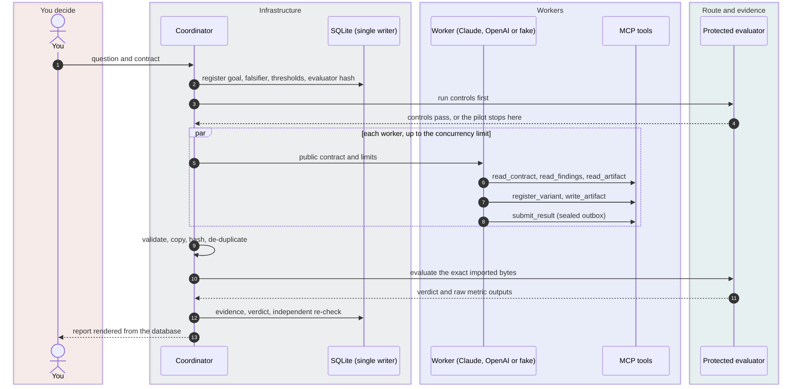
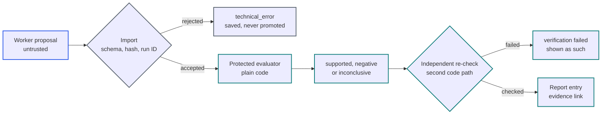
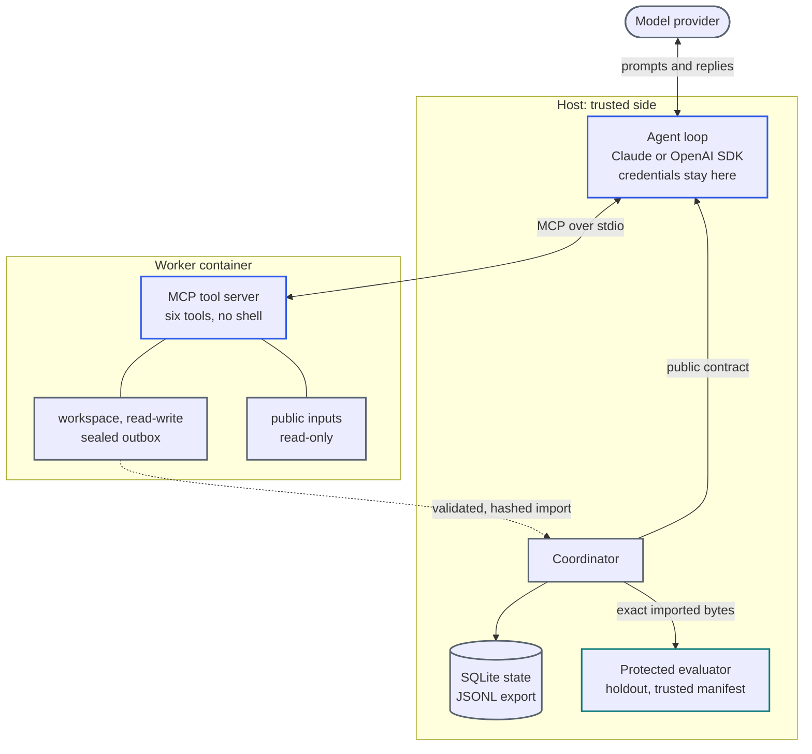

# How it works

One loop from contract to report, the gate every candidate passes, what a worker can see and where
the code lives. The [start page](../README.md#how-it-works) has the short version.

## One loop, step by step



Workers never write to the database. They write to a private outbox that the coordinator treats as
untrusted input. One coordinator per project holds the lock; SQLite stays authoritative, and reports
and the append-only JSONL export are read from it.

## The evidence gate

Every candidate passes the same gate, whatever its outcome:



Execution status, scientific outcome and verification are separate fields: a finished run is not a
finding, a negative result is checked evidence, and an interrupted worker never becomes a positive
one. Result lines in the report are tagged `measured`, `simulated`, `cited`, `assumed`,
`interpretation` or `hypothesis`, and each scored run links its evidence.

## What a worker can see

Isolation does not depend on which agent SDK runs the worker. Every backend gets the same six MCP
tools and nothing else; the tests check the effective tool list for each backend.



- **Never reaches a worker:** evaluator code, holdout and final data, the database, credentials,
  final scores.
- **Two sandbox modes.** `none` serves declarative tools and refuses candidate code. `container`
  runs the tools in an OCI container (Docker or Podman, pinned by digest): no network, read-only
  root, non-root user, no capabilities, limits on processes, memory, CPU and wall time.
- **Fail closed.** Four probes must pass before a container worker starts: private paths absent,
  writes outside the workspace fail, network unreachable, timeouts clean up the whole process tree.
- **Honest limits.** Containers share the host kernel: they stop mistaken or opportunistic worker
  actions, not a determined kernel exploit. See the
  [threat model](DESIGN.md#phase-3b-sandbox-policy-and-threat-model).

## Where the code lives

```text
src/research_loops/
├── coordinator.py, scheduler.py, storage.py      state, dispatch, limits, recovery
├── tools.py, transports/                         the six MCP tools, served over stdio
├── adapters/                                     fake, claude_agent, openai_agents
├── evaluation.py, evaluator_worker.py            protected evaluator subprocess
├── protection.py, authorization.py               hash anchors, run authorization
├── openai_auth.py, auth_cli.py                   Sign in with ChatGPT, protected token store
├── sandbox.py, container_stdio.py                OCI isolation and preflight probes
├── verification.py, grounding.py, reporting.py   re-checks, provenance, reports
├── compute/                                      vendor-neutral training jobs
└── migrations/                                   numbered SQLite migrations
examples/planted-signal/                          the simulated first example
experiments/grain-cnn/                            the U-Net feasibility run
skills/                                           portable agent skills, incl. rloop-coach
docs/                                             lessons, design, decisions, status
tests/                                            offline tests, incl. container isolation
```

Documentation licensed CC BY 4.0.
